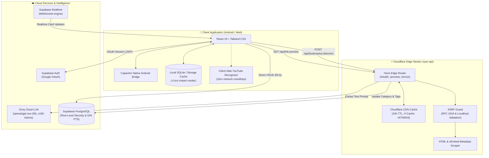
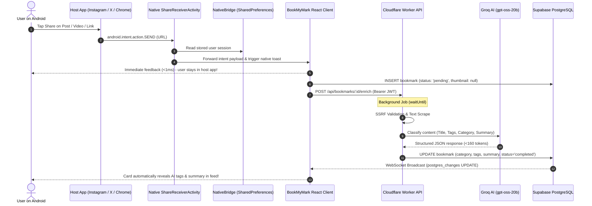
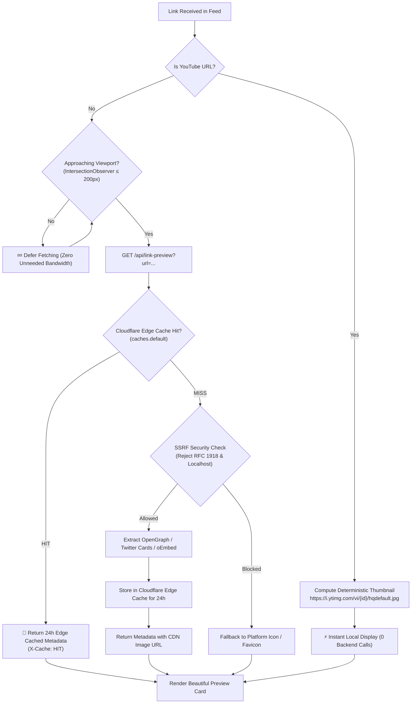

# BookMyMark — Smart Visual Bookmark Library

<div align="center">


<p align="center">
  <b>Personal, Visual, AI-Categorized Knowledge Vault for Android and Web.</b><br/>
  Save Instagram Reels, X (Twitter) threads, YouTube videos, and web articles seamlessly via the native Android Share Menu, with WhatsApp-style cover previews, instant local responsiveness, and automatic text-only Groq AI categorization.
</p>

<!-- 1-Click Android Download Callout -->
[](https://github.com/Pruthviraj141/BookMyMark/releases/latest/download/BookMyMark-debug.apk)
[](https://github.com/Pruthviraj141/BookMyMark/releases/tag/v1.0.0)

<br/>

[](https://opensource.org/licenses/MIT)
[](https://www.typescriptlang.org/)
[](https://react.dev/)
[](https://capacitorjs.com/)
[](https://workers.cloudflare.com/)
[](https://supabase.com/)
[](https://groq.com/)

<br/>

[📲 Android Download](#-android-apk-direct-download) •
[🏗 Architecture](#-system-architecture) •
[🔄 Workflows](#-interactive-working-flows) •
[🌟 Features](#-key-features) •
[🚀 Quickstart](#-quickstart-guide) •
[🛠 Structure](#-project-structure) •
[🌐 API Reference](#-api--endpoints)

</div>

---

## 📲 Android APK Direct Download

Install BookMyMark directly onto your Android device:

| File | Version | Target OS | Direct Download Link |
| :--- | :--- | :--- | :--- |
| **`BookMyMark-debug.apk`** | `v1.0.0` | Android 10+ (API 29–36) | [**⬇️ Download Latest APK**](https://github.com/Pruthviraj141/BookMyMark/releases/latest/download/BookMyMark-debug.apk) |

### ⚡ 3-Step Installation:
1. Tap the [**Download APK link**](https://github.com/Pruthviraj141/BookMyMark/releases/latest/download/BookMyMark-debug.apk) on your Android device.
2. Tap the downloaded file in your browser or File Manager (allow *"Install unknown apps"* if prompted).
3. Open **BookMyMark**, sign in with Google, and start saving bookmarks directly from your Android Share Sheet!

---

## 🏗 System Architecture

BookMyMark is built with a **Local-First, Edge-Assisted** serverless topology. The frontend communicates directly with Supabase for data and authentication, while an edge worker offloads link metadata scraping, edge caching, and AI classification.



---

## 🔄 Interactive Working Flows

### 1. Native Android Share Menu Intake Flow

How a user saves a link with one tap from Instagram, X, or YouTube without interrupting their app experience:



---

### 2. Zero-Database-Storage Link Preview Pipeline

How BookMyMark achieves rich WhatsApp-style previews with **0 bytes of binary image storage** in PostgreSQL:



---

## 🌟 Key Features

| Feature | Description | Architecture Benefit |
| :--- | :--- | :--- |
| **📱 Native Share Intake** | Share links from Instagram, X, YouTube, Reddit, Chrome directly to BookMyMark. | One-tap intake without opening the app or leaving your current screen. |
| **🖼️ WhatsApp-Style Previews** | High-definition card previews without storing images in your database. | Zero storage bloat in PostgreSQL; YouTube resolved locally, others edge-cached for 24 hours. |
| **🤖 Ultra-Fast Groq AI** | Categorizes content and generates summary tags using `openai/gpt-oss-20b`. | Capped at 160 tokens; deduplicates via SHA-256 text fingerprinting. |
| **🔄 Supabase Realtime** | Realtime WebSocket synchronization on database `UPDATE` events. | Eliminates polling; UI updates automatically the moment AI completes. |
| **🔍 Full-Text Search (GIN)** | PostgreSQL weighted full-text search (`search_vector tsvector`). | Instant multi-attribute search across titles, tags, and AI summaries. |
| **📴 Local-First Offline Mode** | Local cache + queued sync operations. | UI loads under 1ms on app open; changes sync automatically when online. |

---

## 🛠️ Project Structure

```
.
├── backend/                       # Cloudflare Worker Edge API
│   ├── src/
│   │   ├── worker.ts              # Hono edge entrypoint (/health, /api/link-preview, /api/bookmarks/:id/enrich)
│   │   ├── index.ts               # Standalone Node.js server entrypoint
│   │   ├── services/
│   │   │   ├── extractor.service.ts       # OpenGraph / oEmbed / Twitter Card parser
│   │   │   ├── groq-classifier.service.ts # Text-only Groq LLM classifier
│   │   │   ├── metadata.service.ts        # Metadata normalization
│   │   │   └── platform.service.ts        # Platform detection logic
│   │   └── utils/                         # URL normalization and SSRF validation
│   ├── tests/                     # Vitest test suite (Auth, Bookmarks, Metadata, Groq)
│   └── wrangler.jsonc             # Cloudflare Worker configuration & bindings
│
├── frontend/                      # React 19 + Capacitor Android Client
│   ├── src/
│   │   ├── components/            # BookmarkCard, MasonryFeed, BottomNavigation, Modals
│   │   ├── context/               # AuthContext (Supabase Google OAuth)
│   │   ├── screens/               # HomeScreen, CategoriesScreen, SearchScreen, SettingsScreen
│   │   ├── services/
│   │   │   ├── bookmarks.service.ts # Direct Supabase database operations
│   │   │   ├── preview.service.ts   # Client-side YouTube & Edge link previews
│   │   │   ├── local-db.service.ts  # Local-first cache and offline sync queue
│   │   │   └── nativeBridge.ts     # Capacitor Android native bridge
│   │   └── config/                # Supabase client & API configuration
│   └── android/                   # Native Android Studio project
│       └── app/src/main/
│           ├── AndroidManifest.xml          # Share sheet intent filter
│           └── java/com/mybookmark/app/
│               ├── MainActivity.java
│               ├── NativeBridgePlugin.kt    # SharedPreferences session bridge
│               └── ShareReceiverActivity.kt # Native Android sharesheet intake
│
├── scripts/                       # Branding and asset generator utilities
├── supabase/
│   └── migrations/                # PostgreSQL schema, RLS, Realtime & FTS GIN index
├── LICENSE                        # MIT License
└── SECURITY.md                    # Security vulnerability reporting policy
```

---

## 🚀 Quickstart Guide

Anyone can clone and run BookMyMark locally in minutes:

### 1. Prerequisites
- **Node.js**: `v20.x` or higher
- **npm** or **pnpm**
- **Supabase Account**: Free project from [supabase.com](https://supabase.com)
- **Groq API Key**: Free key from [console.groq.com](https://console.groq.com)
- **Android Studio & SDK** *(optional, only for building native Android APK)*

---

### 2. Clone the Repository
```bash
git clone https://github.com/Pruthviraj141/BookMyMark.git
cd BookMyMark
```

---

### 3. Database Setup (Supabase)
1. Open your Supabase Dashboard and go to the **SQL Editor**.
2. Run the two migration scripts in sequential order:
   - [`supabase/migrations/20261101000000_create_bookmarks_and_storage.sql`](supabase/migrations/20261101000000_create_bookmarks_and_storage.sql)
   - [`supabase/migrations/20261101120000_enable_realtime_and_fulltext_search.sql`](supabase/migrations/20261101120000_enable_realtime_and_fulltext_search.sql)
3. Under **Authentication → Providers**, enable **Google** (or Email).
4. Under **Database → Replication**, verify that Realtime is toggled ON for the `bookmarks` table.

---

### 4. Backend Setup
```bash
cd backend
npm install
cp .env.example .env
```
Populate `.env` with your Groq and Supabase keys:
```env
GROQ_API_KEY=your_groq_api_key_here
SUPABASE_URL=https://your-project-id.supabase.co
SUPABASE_PUBLISHABLE_KEY=your_supabase_anon_key
SUPABASE_SECRET_KEY=your_supabase_service_role_key
```

Verify the backend test suite:
```bash
npm test
```

Start the backend server:
```bash
npm run dev
# Running at http://localhost:3000
```

*(Optional)* Deploy to Cloudflare Workers:
```bash
npx wrangler deploy
```

---

### 5. Frontend Setup
```bash
cd ../frontend
npm install
cp .env.example .env
```
Edit `.env` with your URLs:
```env
VITE_SUPABASE_URL=https://your-project-id.supabase.co
VITE_SUPABASE_PUBLISHABLE_KEY=your_supabase_anon_key
VITE_API_BASE_URL=http://localhost:3000   # Or your deployed Cloudflare worker URL
```

Launch the Vite development server:
```bash
npm run dev
# App ready at http://localhost:5173
```

---

## 📱 Compiling the Android APK

To build the APK locally from source:

```bash
cd frontend

# 1. Build the web production assets
npm run build

# 2. Sync web bundle to Android native container
npx cap sync android

# 3. Compile the debug APK using Gradle
cd android
./gradlew assembleDebug
```

The resulting APK will be ready at:
```
frontend/android/app/build/outputs/apk/debug/app-debug.apk
```

To install directly to a connected Android phone over USB:
```bash
adb install -r app/build/outputs/apk/debug/app-debug.apk
```

---

## 🌐 API & Endpoints

| Endpoint | Method | Auth | Description | Cache Strategy |
| :--- | :--- | :--- | :--- | :--- |
| `/health` | `GET` | Public | Service health and runtime status check. | No cache |
| `/api/link-preview?url=...` | `GET` | Public | Scrapes OpenGraph, Twitter Card, and oEmbed metadata. | Cloudflare Edge Cache (24 hours, `X-Cache: HIT`) |
| `/api/bookmarks/:id/enrich` | `POST` | Bearer Token | Authenticated background AI categorization via Groq `openai/gpt-oss-20b`. | Background execution (`waitUntil`) |

---

## 📄 License

Distributed under the [MIT License](LICENSE).
