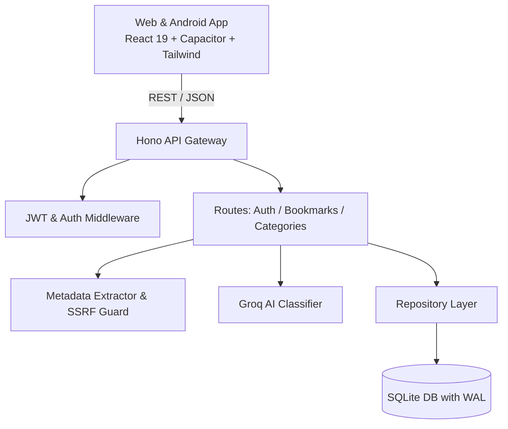

# BookMyMark

<div align="center">


# BookMyMark
### Intelligent, Multi-Platform Bookmark Intelligence & Knowledge Vault

[](https://opensource.org/licenses/MIT)
[](https://www.typescriptlang.org/)
[](https://nodejs.org/)
[](https://hono.dev/)
[](https://react.dev/)
[](https://capacitorjs.com/)
[](https://www.sqlite.org/)
[](https://groq.com/)

<p align="center">
  <b>BookMyMark</b> is a modern, privacy-first SaaS platform designed to capture, organize, and categorize bookmarks seamlessly across the web and mobile. Built with an ultra-fast Hono backend, automated LLM categorization via Groq, rich OpenGraph metadata parsing with SSRF prevention, and a cross-platform React/Capacitor client.
</p>

[Key Features](#-key-features) •
[Architecture](#-architecture) •
[Quickstart](#-quickstart) •
[API Specification](#-api-specification) •
[Contributing](#-contributing) •
[Security](#-security)

</div>

---

## 🌟 Key Features

- **⚡ Lightning-Fast REST API**: Built on [Hono](https://hono.dev/) and powered by `better-sqlite3` with Write-Ahead Logging (WAL) for sub-millisecond query performance.
- **🤖 Automatic AI Categorization**: Seamless background categorization powered by Groq LLM inference, tagging bookmarks with high-accuracy tags and topics.
- **🛡️ Enterprise-Grade SSRF Protection**: Metadata scraper verifies IP ranges against private, loopback, multicast, and link-local CIDRs before fetching previews.
- **📱 True Cross-Platform Experience**: Responsive web application packaged with Capacitor for native Android deployment and seamless intent/share sheet intake.
- **🔒 Secure Authentication**: Industry-standard bcrypt password hashing, JWT bearer authentication, and scoped user isolation across all resources.
- **🔍 Full-Text Search & Filtering**: Instant search across titles, descriptions, categories, tags, platforms (YouTube, Twitter/X, Instagram, GitHub, etc.), and pinned favorites.

---

## 🏗 Architecture



### Directory Structure

```
.
├── backend/                      # Node.js + Hono + SQLite Backend Service
│   ├── src/                      # Controllers, services, repositories & middleware
│   ├── tests/                    # Vitest suite covering auth, bookmarks, AI & metadata
│   └── API_CONTRACT.md           # Exhaustive endpoint documentation
├── frontend/                     # React 19 + Vite + Capacitor Android Application
│   ├── src/                      # Screens, components, hooks & state management
│   └── android/                  # Native Capacitor Android project
├── .github/                      # GitHub issue templates
├── phase1.md                     # Architectural roadmap and specifications
├── phase2.md                     # Android integration and sync roadmap
└── README.md                     # Project documentation
```

---

## 🚀 Quickstart

### Prerequisites
- **Node.js**: `v20.x` or later
- **npm** or **pnpm**
- **Android Studio** *(optional, for native Android builds)*

### 1. Clone the Repository
```bash
git clone https://github.com/Pruthviraj141/BookMyMark.git
cd BookMyMark
```

### 2. Configure Environment Variables
Copy the example environment configurations:
```bash
# Backend configuration
cp backend/.env.example backend/.env

# Frontend configuration
cp frontend/.env.example frontend/.env
```
Update `backend/.env` with your desired `JWT_SECRET` and optional `GROQ_API_KEY`.

### 3. Backend Setup & Run
```bash
cd backend
npm install
npm run dev
```
The API server starts on `http://localhost:3000`.

### 4. Frontend Setup & Run
```bash
cd ../frontend
npm install
npm run dev
```
The client will be running on `http://localhost:5173`.

---

## 🧪 Testing

BookMyMark features comprehensive unit and integration test coverage:

```bash
# Run backend test suite
cd backend
npm test
```

Tests validate:
- **Authentication**: Registration, hashing, token issuance, credential verification.
- **Bookmarks**: CRUD lifecycle, search queries, pagination, tag aggregation.
- **SSRF Mitigation**: Private IP blocklist (RFC 1918, RFC 3927, loopback, IPv6).
- **Metadata Parser**: OpenGraph, Twitter Cards, fallback title/description scraping.

---

## 📖 API Specification

| Method | Endpoint | Description | Auth Required |
|---|---|---|---|
| `POST` | `/api/auth/register` | Register new user account | No |
| `POST` | `/api/auth/login` | Authenticate and obtain JWT | No |
| `GET` | `/api/auth/me` | Fetch authenticated profile | Yes |
| `GET` | `/api/bookmarks` | Search, filter, and paginate bookmarks | Yes |
| `POST` | `/api/bookmarks` | Add new bookmark (triggers background AI & metadata pipeline) | Yes |
| `GET` | `/api/bookmarks/:id` | Fetch bookmark by ID | Yes |
| `PATCH` | `/api/bookmarks/:id` | Update bookmark metadata, notes, or tags | Yes |
| `DELETE` | `/api/bookmarks/:id` | Soft/hard delete bookmark | Yes |
| `GET` | `/api/categories` | List user categories with counts | Yes |
| `GET` | `/health` | Service health status | No |

For comprehensive payload and response schemas, refer to [API_CONTRACT.md](file:///mnt/projects/SignVision/bookmymark/backend/API_CONTRACT.md).

---

## 🔒 Security

- **Safe By Default**: Strictly validated inputs using [Zod](https://zod.dev/).
- **Zero Secrets In VCS**: `.env` and sensitive local files are strictly ignored.
- **SSRF Protection**: URL fetching routines validate DNS resolution against internal RFC ranges before issuing HTTP requests.
- **Data Isolation**: Multi-tenant database queries enforce `user_id` ownership on every single read and write.

---

## 🤝 Contributing

Contributions are warmly welcomed! Please read our [Contributing Guide](CONTRIBUTING.md) to get started.

1. Fork the Project
2. Create your Feature Branch (`git checkout -b feature/AmazingFeature`)
3. Commit your Changes (`git commit -m 'feat: Add some AmazingFeature'`)
4. Push to the Branch (`git push origin feature/AmazingFeature`)
5. Open a Pull Request

---

## 📄 License

Distributed under the MIT License. See [LICENSE](LICENSE) for more details.
